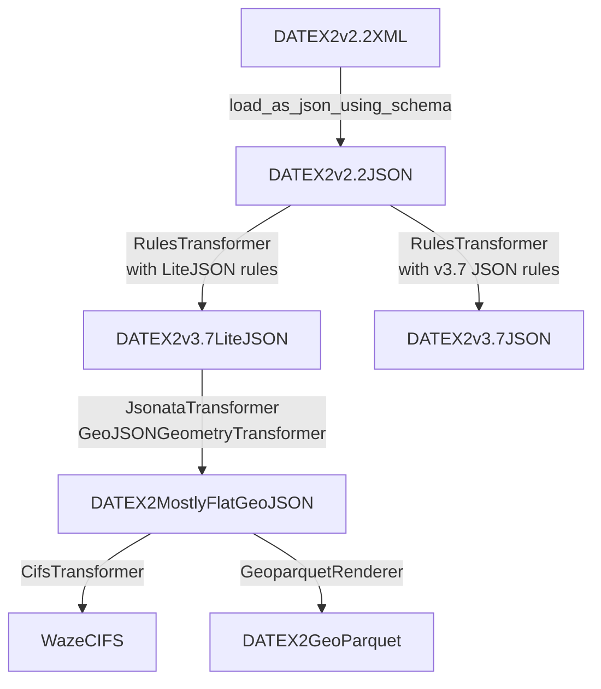

# DATEX2-XML2JSON (Proof of Concept)

This tool provides a PoC converter to convert DATEXII XML to JSON or GeoParquet format. 

As output format, the following formats are supported

* DATEXII v3.7 JSON
* a custom DATEXII 3.7 (we call it "DATEXII v3.7 JSON Lite") variation which deviates from official schema but is easier to process (see below)
* a (mostly) flattened GeoJSON
* a geoparquet format derived from above mostly flat GeoJSON format.

Curently, supported DATEXII input is limited to `SituationPublication`s in DATEXII v2.x.

Note: This tool uses XML schemas to derive cardinality and type information for the JSON conversion to JSON.
Custom extensions might require supplying specific schemas to support this conversion.

## Preliminaries

This project requires Python >= 3.12.

Install the needed dependencies via 

```
$ pip install -r requirements.txt
```

### Usage

Below, you find a couple of sample formats to generate different output formats.

If you encounter issues, i.e. an invalid DATEXII v3.7, you might consult the [troubleshooting guide](doc/troubleshooting.md). 
If this is does not help, please open an issue and supply a minimal DATEXII XML sample and your command to reproduce the issue.

In case you fixed an error or want to contribute, please create an issue as well and feel free to send a PR, thanks.

#### DATEXII v3.7
To convert a DATEXII v2.2 XML publication to DATEXII v3.7, use the following command. It will create `out/situation_publication.json` and will validate it after generation.

```sh 
python -m datex2_xml2json.transform -f datex2_3_7_json -V situation_publication.xml
```

#### DATEXII (mostly) flat GeoJSON

To convert a DATEXII v2.2 XML situation publication to a (mostly) flat GeoJSON file, use the following command. It will create `out/situation_publication.geojson`.  Note that this is a lossy conversion which retains a subset of all possible DATEXII properties. For details which elements are picked, see `jsonata_transformer.py`.

```sh
python -m datex2_xml2json.transform -f geojson situation_publication.xml
```

#### DATEXII Geoparquet

To convert a DATEXII v2.2 XML publication to a Geoparquet file, use the following command. It will create out/situation_publication.geoparquet.


Note that all timestamp properties are exported as UTC timestamps, their original offsets applied.

```sh
python -m datex2_xml2json.transform -f geoparquet situation_publication.xml
```


#### DATEXII v3.7 JSON Lite

To convert a DATEXII v2.2 XML publication to a DATEXII v3.7 JSON "Lite" format, use the following command. It will create `out/situation_publication.lite.json`:

```sh
python -m datex2_xml2json.transform -f datex2_3_7_json_lite situation_publication.xml
```

Warning: the JSON resulting from this conversion does not comply with DATEXII JSON Schema. 

Some differences:
* this format does not use the DATEXII part 15 xsi-type dependant wrapper objects, but keeps the `xsi:type` attribute as property `type`.
* it does not wrap text objects in `value` wrappers
* we try to create a `geoJsonGeometry` location from `gmlLineString` locations. For `locationContainedInGroup`, we collect all linestrings in an `MultiLineString` object

#### DATEXII v2.2 RAW JSON

To convert a DATEXII v2.2 XML publication to an intermediate JSON which just converts the XML to a JSON file using the DATEXII v2.2 schema, use the following command. It will create `out/situation_publication.raw.json`.
```sh
python -m datex2_xml2json.transform -f raw situation_publication.xml
```

#### WAZE CIFS Format

To convert a DATEXII v2.2 XML situation publication to [WAZE CIFS Format](https://developers.google.com/waze/data-feed/cifs-specification?hl=de), use the following command. It will create `out/situation_publication.cifs.json`.

```sh
python -m datex2_xml2json.transform -f cifs situation_publication.xml
```

To validate the generated json against the CIFS schema, supply the -v switch.
```sh
python -m datex2_xml2json.transform -f cifs -V situation_publication.xml
```

Note: currently, this converter does not handle validityPeriods. I.E. recurring events at specific days/hours are not yet mapped to CIFS schedule.


#### Generating multiple output formats in one run

To convert a DATEXII v2.2 XML situation publication to WAZE CIFS Format, GeoJSON and Geoparquet in one run (which avoids repeated parsing/transformation steps), run the following command (without explicitly specifing a format parameter):
It will create `out/situation_publication.datex2.raw.json`, `out/situation_publication.datex2.lite.json`, `out/situation_publication.datex2.geojson`, `out/situation_publication.datex2.parquet` and`out/situation_publication.cifs.json`.

```sh
python -m datex2_xml2json.transform situation_publication.xml
```

### How the transformation works

This converter runs multiple conversion steps which create intermediate formats which are used as homogenized input for subsequent transformation steps.

The following chart describes this conversion chain:



### Working with JSONata
[JSONata](https://jsonata.org/) is a powerful transformation language to define mappings between different JSON formats.
Easiest way to learn about it, is starting with an existing transformation using the [JSONata.org online editor](https://try.jsonata.org/).

E.g. you could start with the following to example transformations (which might not exactly reflect the latest code version of this project):

* https://try.jsonata.org/Gk5r-kLek: Mapping DATEX3.7LiteJSON to DATEX2MostlyFlatGeoJSON (Current JSONata expression is in datex2_xml2json/transform/jsonata_transformer.py)
* https://try.jsonata.org/QEnqmItyF: Mapping DATEX2MostlyFlatGeoJSON to (mostly) WAZE CIFS (Current JSONata expression is in datex2_xml2json/transform/cifs_transformer.py)
